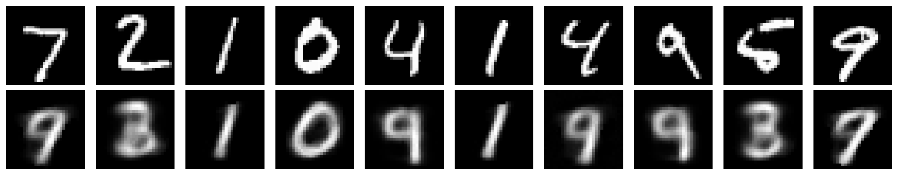
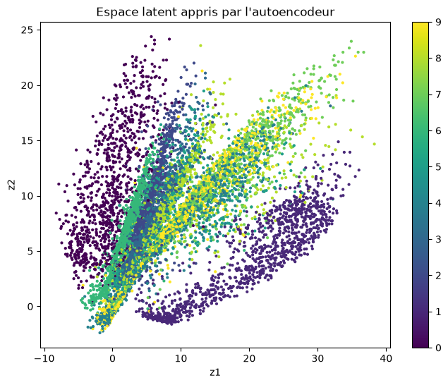
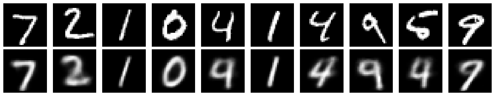
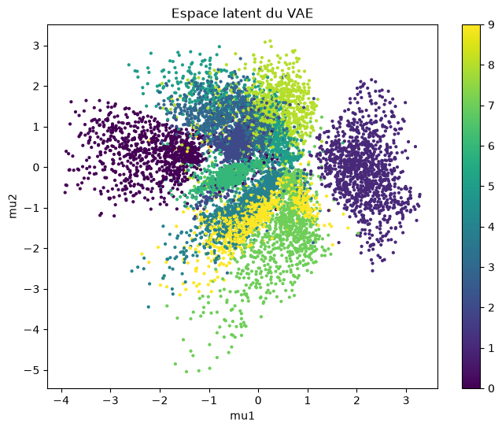
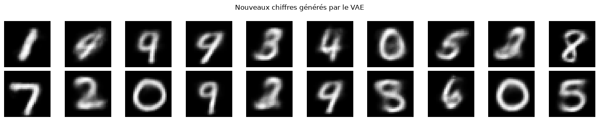
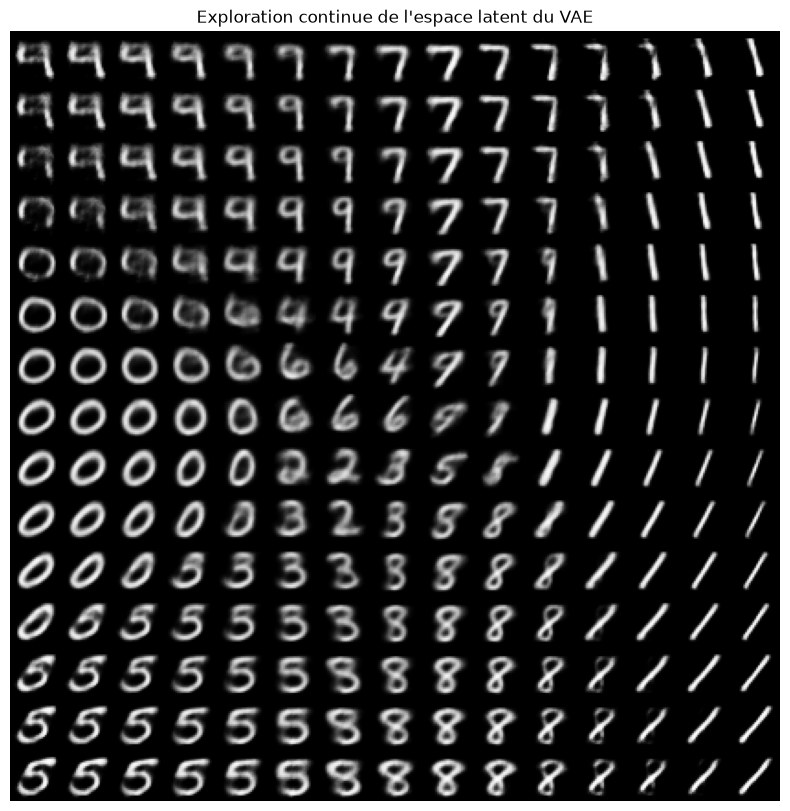

# TP – Modèles génératifs avec PyTorch (MNIST)

Création, entraînement, évaluation et exploration de modèles sur le dataset MNIST :

1. **Modèle discriminatif** : classifieur MLP (≈ 96 % d'accuracy sur le test, mesurée avec `torcheval`)
2. **Autoencodeur simple** : espace latent 2D, reconstruction, visualisation, génération d'un chiffre moyen
3. **VAE** : perte ELBO (BCE + KL), reconstruction, espace latent, génération par échantillonnage, exploration d'une grille latente

Notebook : [`Aicha_modeles_generatifs.ipynb`](Aicha_modeles_generatifs.ipynb) (sorties incluses).

## Installation (UV)

```bash
uv sync                      # crée .venv et installe les dépendances
source .venv/bin/activate    # Windows : .venv\Scripts\activate
```

Ouvrir ensuite le notebook dans VS Code et choisir le kernel `.venv`.
MNIST est téléchargé automatiquement dans `./data` (ignoré par git).

## Reproduire le projet depuis zéro

```bash
uv init --python=3.11
uv venv
uv add ipykernel torch torchvision torcheval matplotlib
```

## Résultats (jeu de test)

| Modèle | Métrique | Valeur |
|---|---|---|
| Classifieur MLP (3 époques) | Accuracy | 96,29 % |
| Autoencodeur (latent 2D, 5 époques) | MSE de reconstruction | 0,0451 |
| VAE (latent 2D, 20 époques) | Perte ELBO par image | 144,0 (reconstruction 137,7 + KL 6,4) |

> Les métriques de l'autoencodeur (MSE) et du VAE (BCE + KL) ne sont pas comparables entre elles : elles n'ont pas la même échelle.

## Aperçu

### Autoencodeur (latent 2D)

| Reconstruction (ligne 1 : originaux, ligne 2 : reconstruits) | Espace latent |
|---|---|
|  |  |

### VAE (latent 2D)

| Reconstruction (ligne 1 : originaux, ligne 2 : reconstruits) | Espace latent |
|---|---|
|  |  |

| Génération (z ~ N(0, I)) | Exploration continue de l'espace latent |
|---|---|
|  |  |

## Analyse

- **Classifieur** : environ 96 % d'accuracy en 3 époques avec un simple MLP ; la tâche discriminative est facile sur MNIST.
- **Autoencodeur** : avec seulement 2 dimensions latentes, la reconstruction est floue et plusieurs chiffres sont confondus (par exemple 7→9, 2→3, 4→9). Son espace latent n'est pas régularisé : il est très étalé (z1 de −10 à 40 environ), non centré, et les classes se chevauchent fortement (seuls les 0 et les 1 sont assez bien isolés). Il est donc difficile de choisir un point z à décoder pour générer un chiffre.
- **VAE** : le terme KL contraint l'espace latent vers N(0, I). Les points sont concentrés autour de 0 (environ −4 à 3), les classes forment des groupes plus compacts (0 et 1 bien séparés, mais 4, 7 et 9 se mélangent encore). On peut échantillonner z ~ N(0, I) pour générer de nouveaux chiffres, et la grille latente montre des transitions continues entre les classes (0 → 6 → 5 → 8, 7 → 1…).
- **Limites** : avec un latent de dimension 2, les deux modèles confondent encore certains chiffres proches (4/9/7). Une dimension latente plus grande améliorerait la reconstruction, au prix de la visualisation directe.

### Perte du VAE (ELBO)

`L = BCE(x_hat, x) + β · KL(q(z|x) || N(0, I))`, avec `KL = -½ Σ (1 + log σ² − μ² − σ²)`.
